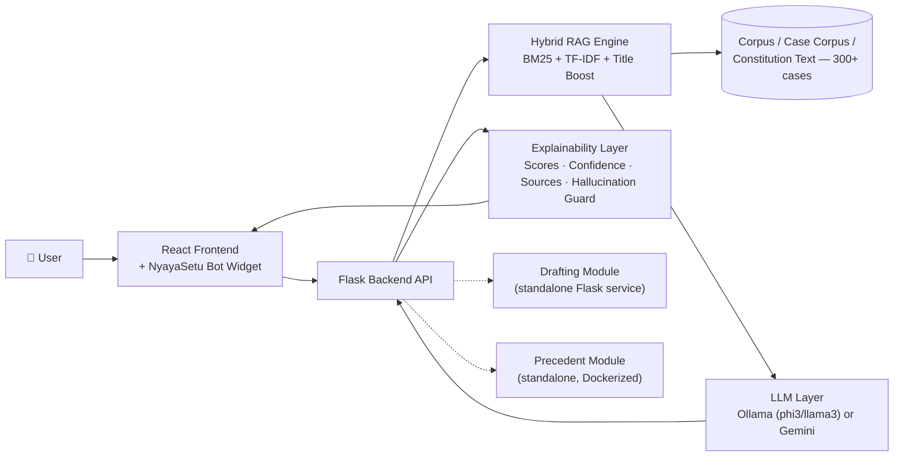

<div align="center">

[](https://www.python.org/)
[](https://flask.palletsprojects.com/)
[](https://react.dev/)
[](https://ollama.com/)
[](https://www.docker.com/)
[](./LICENSE)
[](https://github.com/aryandhole594-art/NyayaSetu/stargazers)

</div>

## Table of Contents

- [Overview](#-overview)
- [Features](#-features)
- [Architecture](#-architecture)
- [Assets & Media](#-assets-media)
- [Tech Stack](#-tech-stack)
- [Getting Started](#-getting-started)
- [Configuration](#-configuration)
- [API Reference](#-api-reference)
- [Project Structure](#-project-structure)
- [Contributing](#-contributing)
- [Team](#-team)
- [License](#-license)
- [Acknowledgements](#-acknowledgements)
- [Disclaimer](#-disclaimer)

## Overview


**NyayaSetu** (*"Bridge to Justice"*) is a comprehensive AI-powered legal platform for **Indian Constitutional Law**, combining Retrieval-Augmented Generation (RAG), legal document drafting, precedent analysis, constitutional rights compliance, and interactive legal assistance within a unified modular architecture.

<br>


Legal research is often expensive, time-consuming, and difficult for ordinary citizens to access. NyayaSetu democratizes constitutional knowledge by enabling lawyers, students, and the public to perform legal research, generate legal documents, analyze precedents, understand constitutional rights, and receive explainable AI-assisted guidance from a single platform.

<br>


The platform is powered by a **hybrid RAG pipeline** using **BM25 + TF-IDF + Title Boosting** over a curated corpus of **300+ Indian legal case documents**. Responses are generated using **Ollama** (`phi3` / `llama3`) for fully offline inference or **Gemini** as an optional cloud fallback. Every response includes an explainability layer featuring retrieval scores, confidence estimates, cited legal sources, and hallucination safeguards for transparent and trustworthy legal reasoning.


## Features

<table>
<tr><td width="50%" valign="top">

### 🤖 Legal Chatbot & Bot Widget
- Multi-intent chatbot with site knowledge + intent classification
- Floating bot widget: *Legal Assistant* mode (routed through `/api/chat`) and *Site Guide* mode (static knowledge base)
- Confidence badges, source citations, quick actions, page-aware prompts
- Shared bot source across backend and frontend for easy embedding (`bot_widget.html` template)

### 🔎 Hybrid Retrieval & RAG
- BM25 + TF-IDF + title boosting, with explainability scores per result
- Local LLM inference via Ollama (`phi3`/`llama3`), Gemini as optional fallback

### 📚 Precedent Module
- Precedent evaluation, legal concept extraction, advanced legal toolkits
- Modular document ingestion & evaluation
- Dockerized for isolated deployment

### 📜 Rights Analysis Module
- Automated compliance checking against rights mappings
- Corpus loader for legal rights data
- Situation classifier to contextualize legal issues

</td><td width="50%" valign="top">

### ⚖️ Judgment Prediction
- Predictive models for likely legal judgment outcomes
- Dedicated frontend components for visualization

### 📝 Drafting Module
- Automated drafting of affidavits, agreements, letters, and NOCs
- Template-driven document assembly
- Document ingestion and processing utilities

### 🧰 Advanced Legal Tools
- Fairness checker · Rights card generator · Layman ⇄ legal translator · Article comparison tool
- Explainability + hallucination-guard on AI outputs

### 📄 Document Intelligence
- Upload PDF/DOCX/image and merge extracted text into the corpus
- Contract risk analyzer (regex + constitutional RAG grounding)
- Court notice decoder (deadline extraction + section grounding)

### 🗂️ Legal Corpus & Testing
- 300+ legal case texts for retrieval, learning, and benchmarking
- Python test suite covering intent classification, fairness, hallucination guard, and retrieval quality

</td></tr>
</table>

## Architecture

> Placeholder diagram below — swap this out for the real architecture diagram once it's ready (drop it in `assets/architecture.png` and replace the Mermaid block, or keep both).




## Assets & Media

This section is a placeholder checklist for the media you're planning to add:

- [ ] **Banner** — `assets/banner.png` (referenced at the top of this README)
- [ ] **Architecture diagram** — `assets/architecture.png`
- [ ] **UI screenshots** — e.g. `assets/screenshots/chat-widget.png`, `assets/screenshots/rights-card.png`
- [ ] **Demo video/GIF** — e.g. `assets/demo.gif` or a linked YouTube walkthrough

Once added, screenshots typically go in as:
```markdown
<p align="center">
  
  
</p>
```
And a demo video as a clickable thumbnail:
```markdown
[](https://youtu.be/your-video-id)
```

## Tech Stack

| Layer | Technology |
|---|---|
| Backend | Flask (Python) |
| Frontend | React |
| LLM | Ollama (local) or Gemini (optional, cloud) |
| Retrieval | BM25 + TF-IDF hybrid scoring |
| OCR | Tesseract (for scanned PDFs / images) |
| Standalone services | Drafting module, Precedent module (own `app.py` + `requirements.txt` each) |
| Deployment | Docker — root `docker-compose.yml`, plus per-module Dockerfiles (e.g. Precedent module) |


## Getting Started

### Prerequisites
- Python 3.10+
- Node.js + npm/yarn
- [Tesseract](https://github.com/tesseract-ocr/tesseract) binary for scanned-document OCR (e.g. `brew install tesseract` on macOS)
- [Ollama](https://ollama.com/) installed locally for the offline LLM path
- Docker (optional, for containerized deployment)

### 1. Backend
```bash
cd backend
pip install -r requirements.txt
python app.py
```
Runs on **http://127.0.0.1:5555**

### 2. Frontend
```bash
cd frontend
npm install
npm start
```
Runs on **http://localhost:3000** — open `/ai-legal-tools` for the modular reasoning UI.

### 3. Drafting & Precedent modules (optional, standalone services)
```bash
cd drafting_module
pip install -r requirements.txt
python app.py
```
```bash
cd precedent_module
pip install -r requirements.txt
python app.py
```

### 4. Docker (optional)
A root `docker-compose.yml` is included for a containerized setup, and the Precedent module ships its own `Dockerfile` for isolated deployment.

## ⚙️ Configuration

Copy `config.example.yaml` → `config.yaml` in the repo root and adjust as needed:

```yaml
llm_provider: "ollama"
ollama_model: "phi3"
ollama_host: "http://localhost:11434"
ollama_timeout: 180
ollama_num_predict: 900
gemini_model: "gemini-1.5-flash"
```

- Optional Gemini fallback: set `GEMINI_API_KEY` in a `.env` file at the repo root.
- Additional service endpoints can be set via environment variables.
- Keep `case_corpus/` and `backend/data/` intact — full feature access depends on these.
- To build a custom corpus, use `corpus/generate_sample_pdfs.py`.

> **Don't commit:** `config.yaml`, `.venv/`/`venv/`, `__pycache__/`, frontend build output, or local scratch files like `context.txt`/`commands.txt`. Ollama model weights aren't stored in the repo either.

---

## API Reference

<details>
<summary><b>Core</b></summary>

**`POST /legal-help`**
```bash
curl -X POST http://127.0.0.1:5555/legal-help \
  -H "Content-Type: application/json" \
  -d '{"query": "Police arrested me without telling the reason"}'
```

**`POST /api/chat`**
```bash
curl -X POST http://127.0.0.1:5555/api/chat \
  -H "Content-Type: application/json" \
  -d '{"query":"Can my landlord evict me without notice?","conversation_history":[]}'
```
</details>

<details>
<summary><b>Reasoning tools</b></summary>

All `/api/*` reasoning endpoints return a standard response shape:
```json
{
  "status": "success | insufficient_data | error",
  "feature": "feature_name",
  "data": {},
  "explainability": {
    "retrieved_chunks": [],
    "retrieval_scores": [],
    "domain_filter_applied": "domain",
    "confidence": 0.0,
    "sources": [],
    "reasoning_steps": [],
    "unverified_claims": []
  },
  "warnings": [],
  "confidence": 0.0
}
```

| Endpoint | Purpose |
|---|---|
| `POST /api/fairness-check` | Assess fairness of a described situation |
| `POST /api/rights-card` | Generate a rights card for a given `rights_type` |
| `POST /api/simulate-scenario` | Walk through likely outcomes for a scenario |
| `POST /api/translate` | Convert plain language ⇄ legal language |
| `GET /api/amendments` / `GET /api/amendments/{article_number}` | Constitutional amendment history |
| `POST /api/compare-articles` | Compare two constitutional articles |

</details>

<details>
<summary><b>Document intelligence</b></summary>

| Endpoint | Purpose |
|---|---|
| `POST /document-intel/upload` | Multipart upload of PDF/DOCX/image |
| `POST /document-intel/contract-analyze` | Contract risk analysis (regex + constitutional RAG grounding) |
| `POST /document-intel/court-notice-decode` | Court notice deadline extraction + section grounding |

</details>

<details>
<summary><b>Standalone services</b></summary>

The **Drafting module** and **Precedent module** each run as their own Flask service (own `app.py`/`requirements.txt`), so document drafting and precedent evaluation can be scaled or deployed independently of the main backend.

</details>

<details>
<summary><b>🚧 Planned / stub endpoints (HTTP 501)</b></summary>

`/api/document-analyzer` · `/api/petition-draft` · `/api/landmark-cases?topic=` · `/api/bail-eligibility` · `/api/legal-timeline`

</details>

## 📁 Project Structure

```
NyayaSetu/
├── backend/
│   ├── app.py
│   ├── requirements.txt
│   ├── routes/          # chat, comparator, fairness, amendments, stubs
│   ├── features/
│   ├── data/
│   ├── static/
│   └── templates/
├── frontend/
│   ├── src/
│   │   ├── App.js
│   │   └── components/
│   ├── public/
│   └── package.json
├── drafting_module/
│   ├── app.py
│   ├── templates/        # affidavit / agreement / letter / NOC templates
│   └── requirements.txt
├── precedent_module/
│   ├── app.py
│   ├── requirements.txt
│   └── Dockerfile
├── rights_module/
├── case_corpus/           # 300+ legal case texts
├── corpus/                # general legal corpus + generate_sample_pdfs.py
├── legal_templates_pdf/
├── static/bot/            # shared bot widget assets (mirrored in backend/frontend)
├── tests/                 # intent classification, fairness, hallucination-guard, retrieval tests
├── config.example.yaml
├── docker-compose.yml
├── LICENSE
└── README.md
```

Backend feature code lives under `backend/features`, route blueprints under `backend/routes`, shared wrappers under `backend/utils`, and structured data under `backend/data`. Constitution text loads from `backend/constitution.txt`, falling back to `backend/static/constitution.pdf` if missing.

## Contributing

Contributions are welcome — the repo is organized by feature/module, so it's easy to work in one area without touching the rest:

- **Backend logic:** `backend/`
- **Frontend React app:** `frontend/`
- **Precedent & drafting modules:** `precedent_module/`, `drafting_module/`
- **Legal corpus:** `case_corpus/`, `backend/data/`
- **Bot & UI assets:** `static/bot/`, `backend/static/bot/`, `frontend/public/static/bot/`
- **Tests:** `tests/`

Fork the repository, create a feature branch, and submit a pull request for review.

## 👥 Team

Built by **VIT-ITA-GR-13, Batch 2027**:

- Aryan Dhole
- Dhruva Sharma
- Divyansh Pandey
- Pranjali Diwan
- Shashwat Diwan

## 📜 License

Released under the [MIT License](./LICENSE).

## 🙏 Acknowledgements

NyayaSetu brings together AI, law, and open-source software to improve access to justice and legal technology. Thanks to all contributors and the open-source community for their continued support.


## ⚠️ Disclaimer

NyayaSetu provides **informational guidance only** and does not constitute legal advice. For matters requiring formal legal representation, please consult a qualified advocate.
